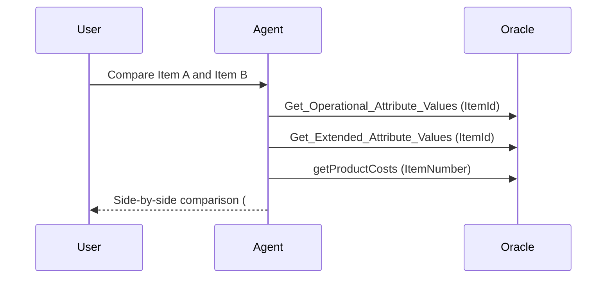

# Product-Comparison-Advisor

<div align="center">

[](https://github.com/Shreyansh2203/Product-Comparison-Advisor---AI-Agent/actions)
[](https://github.com/Shreyansh2203/Product-Comparison-Advisor---AI-Agent/security/code-scanning)
[](https://github.com/Shreyansh2203/Product-Comparison-Advisor---AI-Agent/actions/workflows/json-validate.yml)
[](LICENSE)
[](https://www.python.org/)
[](https://docs.oracle.com/)

</div>

<details open>
<summary><b>Table of Contents</b></summary>

- [Overview](#overview)
- [What This Is](#what-this-is)
- [Data Flow & Tools](#data-flow--tools)
- [Artifacts](#artifacts)
- [Project Structure](#project-structure)
- [Quick Start](#quick-start)
- [Validation](#validation)
- [Agent Configuration](#agent-configuration)
- [Known Limitations](#known-limitations)
- [Tech Stack](#tech-stack)
- [Testing](#testing)
- [Deployment](#deployment)
- [Contributing](#contributing)
- [License](#license)

</details>

---

## Overview

**Product-Comparison-Advisor** is an Oracle AI Agent configuration package — not a deployable web application. It ships a validated Oracle AI Agent JSON definition (`PRODUCT_COMPARATOR_V13.json`) plus validation tooling to ensure the agent contract, attribute schema, and prompt contract remain consistent across changes. The agent compares 63 product and manufacturing attributes across the 30 operational-attribute fields, with the 30 operational-attribute fields documented in the agent configuration.

Use this repository as the source of truth for the Product Comparison Advisor agent definition in Oracle Cloud Infrastructure.

---

## What This Is

This is **agent configuration only** — there is no HTTP server, no port to run, and no deployable runtime artifact. The repository contains:

- **`PRODUCT_COMPARATOR_V13.json`** — the Oracle AI Agent workflow specification (pipeline nodes, model configuration, inputs, error handlers)
- **`scripts/validate_agent.py`** — JSON schema and contract validation
- **`scripts/prompt_contract.py`** — prompt contract validation
- **`scripts/prompt_fixtures.py`** — prompt test fixtures
- **`tests/`** — agent config, attribute count, and prompt contract tests

If you're looking for a runnable service, this is not it. If you're managing the Product Comparison Advisor agent definition, this is the canonical source.

---

## Data Flow & Tools



The agent uses three read-only GET tools to query Oracle SCM Cloud APIs:

- **`Get_Operational_Attribute_Values`**: Queries `/fscmRestApi/resources/11.13.18.05/itemOperationalAttributes` for core operational and manufacturing attributes.
- **`Get_Extended_Attribute_Values`**: Queries `/fscmRestApi/resources/11.13.18.05/itemExtendedAttributes` for user-defined descriptive flexfield attributes.
- **`getProductCosts`**: Queries `/fscmRestApi/resources/11.13.18.05/itemsV2` for unit and item manufacturing costs.

Output format: **Show only the differences** between items in side-by-side comparison tables, highlighting differing cells using background colour `#ffe6e6`.

---

## Artifacts

| Artifact | Purpose |
|----------|---------|
| `PRODUCT_COMPARATOR_V13.json` | Oracle AI Agent V13 workflow specification |
| `scripts/validate_agent.py` | Agent JSON validation entry point |
| `scripts/prompt_contract.py` | Prompt contract enforcement |
| `scripts/prompt_fixtures.py` | Reusable prompt fixtures for tests |
| `tests/test_agent_config.py` | Agent configuration assertions |
| `tests/test_attribute_count.py` | Attribute count validation |

---

## Project Structure

```
Product-Comparison-Advisor/
├── PRODUCT_COMPARATOR_V13.json   # Oracle AI Agent V13 specification
├── Dockerfile                    # Container definition (config-only image)
├── .github/workflows/
│   ├── ci.yml
│   ├── codeql.yml
│   └── json-validate.yml
├── scripts/
│   ├── validate_agent.py       # agent JSON validation
│   ├── prompt_contract.py      # prompt contract checks
│   └── prompt_fixtures.py      # prompt fixtures
├── tests/
│   ├── test_agent_config.py
│   └── test_attribute_count.py
├── .pre-commit-config.yaml
├── .gitignore
└── LICENSE
```

---

## Quick Start

### Prerequisites

- Python 3.12+

### Validate the Agent

```bash
cd Product-Comparison-Advisor

# Validate the agent JSON
python scripts/validate_agent.py PRODUCT_COMPARATOR_V13.json

# Run the full test suite
python -m unittest discover -s tests -v
```

### Docker

```bash
docker build -t product-comparison-advisor .
docker run --rm product-comparison-advisor python scripts/validate_agent.py PRODUCT_COMPARATOR_V13.json
```

---

## Validation

CI runs three gates on every push:

| Gate | Workflow | Purpose |
|------|----------|---------|
| **CI** | `ci.yml` | General build & test |
| **CodeQL** | `codeql.yml` | SAST security scanning |
| **JSON Validation** | `json-validate.yml` | Agent JSON schema validation |

Run locally:

```bash
# All tests
python -m unittest discover -s tests -v

# Agent validation only
python scripts/validate_agent.py PRODUCT_COMPARATOR_V13.json

# Prompt contract
python scripts/prompt_contract.py
```

---

## Agent Configuration

The agent is defined in `PRODUCT_COMPARATOR_V13.json` as an Oracle AI Agent `Workflow.spec`:

```json
{
  "Specification": {
    "dataPipeline": {
      "rootNode": "end",
      "pipelineNodes": [ /* ... */ ],
      "errorHandlers": [ /* email handler with toList, ccList, subject, body */ ]
    },
    "modelConfiguration": {
      "model": "OCI_GPT_5_MINI",
      "modelName": "Gpt-5 Mini",
      "provider": "CERT_PREMIUM",
      "max_completion_tokens": 8000,
      "reasoning_effort": "medium"
    }
  }
}
```

Key model properties:
- **Model:** `OCI_GPT_5_MINI` (Gpt-5 Mini)
- **Provider:** `CERT_PREMIUM`
- **Max completion tokens:** 8000
- **Reasoning effort:** medium

---

## Known Limitations

The validator asserts that any unresolvable Oracle export facts are explicitly recorded rather than silently ignored:

| Code | Reason |
|---|---|
| `model-code` | Oracle assigns modelConfiguration.code when the agent is exported, and the model is selected by model/modelName/provider rather than by this code. |
| `partner-metadata` | partnerMetadata.Name is an opaque four-character value whose provenance is not recorded anywhere in this repository. |
| `pipeline/error-handler` | The EMAIL error handler's recipient, subject, and body are tenant facts configured at import time. |
| `trigger/rest-empty` | The REST trigger's endpoint contract belongs to whichever system calls the agent and is configured at import time. |
| `max-interactions/scope` | The document declares two fields named MaximumInteractions: the agent's (20), and team-level budget. |
| `tool/parameter-unbound` | getProductCosts declares four ProductCosts.* filter parameters that never appear in its resourcePath. |

---

## Tech Stack

- [Python 3.12+](https://www.python.org/)
- [unittest](https://docs.python.org/3/library/unittest.html) — testing
- [CodeQL](https://codeql.github.com/) — SAST
- [Docker](https://www.docker.com/) — container definition

---

## Testing

```bash
# Full suite
python -m unittest discover -s tests -v

# Agent validation only
python scripts/validate_agent.py PRODUCT_COMPARATOR_V13.json
```

CI enforces all tests passing on `main` and pull requests.

---

## Deployment

This is configuration-only. There is no runtime to deploy. The `Dockerfile` produces a validation image that runs `validate_agent.py` against `PRODUCT_COMPARATOR_V13.json` — suitable for CI/CD gating, not for serving traffic.

When importing into Oracle Cloud Infrastructure AI Agent Studio, two import-time steps must be finished by the operator:
1. **`errorHandlers`**: Configure the recipient email address (`toList`), subject, and body for pipeline errors.
2. **`triggers`**: Define the REST trigger calling endpoint contract and authentication scheme for inbound requests.

To promote a new agent version:
1. Edit `PRODUCT_COMPARATOR_V13.json`
2. Update version in the filename if major (e.g. `V14`)
3. Run `python scripts/validate_agent.py PRODUCT_COMPARATOR_V13.json`
4. Run `python -m unittest discover -s tests -v`
5. Commit and open a Pull Request

---

## Contributing

1. Fork the repo
2. Create a feature branch (`git checkout -b feat/your-feature`)
3. Update `PRODUCT_COMPARATOR_V13.json` and/or scripts
4. Run validation + tests
5. Commit and open a Pull Request

---

## License

Distributed under the **MIT License**. See [LICENSE](LICENSE) for details.

---

<div align="center">

**Made with ❤️ by [Shreyansh Srivastava](https://github.com/Shreyansh2203)**

[](https://github.com/Shreyansh2203/Product-Comparison-Advisor---AI-Agent/stargazers)
[](https://github.com/Shreyansh2203/Product-Comparison-Advisor---AI-Agent/network)

</div>
